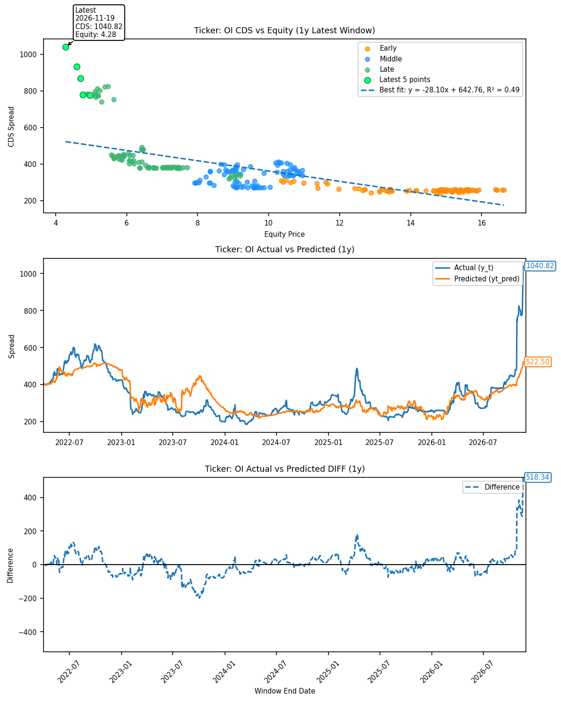

<h1 align="center"><b>Credit report: OI (OI European Group B.V.)</b></h1>

<i>From <code>TEMPLATE.md</code>. Updated 2026-11-23. USD mm. Status: done / partial / todo. Filings in <code>financial_statements/companies/oi/filings/</code>.</i>

## Market snapshot

- 5Y CDS 1,041bp on 19 Nov 2026 vs 433bp at 30 Sep and 257bp at YE25. Equity $4.28 vs $14.76 at YE25.1
- Step 28 Oct (491 to 753bp), the day after the Q3 release and guidance cut.2 Second leg 17-19 Nov (779 to 1,041bp), cause not identified.
- CDS is about 520bp wider than the 1y equity regression implies: credit is pricing worse than equity.1

Sources: 1) Markit CDS (Databricks) and equity prices via the cache of `claude_repos/timeseries_slideshow_tool`, through 19 Nov 2026; chart made by `credit_reports/make_chart.py` · 2) [Q3'26 earnings release, 27 Oct 2026](../financial_statements/companies/oi/filings/earnings/oi_2026-10-27_8-K_tm2628380d1_ex99-1.htm) ([SEC](https://www.sec.gov/Archives/edgar/data/812074/000110465926119192/tm2628380d1_ex99-1.htm))

## CDS reference & deliverables
- CDS: OI, XO index. Markit `OI-Egp` (SNRFOR, EUR, MM14, 500bp). RED `NTD74V`. BBG curve CY351713.1
- Reference entity: OI European Group B.V. (OIEG), private Dutch subsidiary of O-I Glass (NYSE: OI, CIK 0000812074).1,2
- Deliverable (OIEG's own notes): EUR 600mm 6.25% 2028, EUR 500mm 5.25% 2029, USD 400mm 4.75% 2030 (the mappings bond proxy, ISIN USN6704RAK79).1,3,4
- Not deliverable: OBGC notes. Exhibit 21 nests OIEG under OBGC (parent); a sibling relationship would give the same answer.5

Sources: 1) [CDS mappings file](../../cds_mappings/cds_mappings_final.csv) · 2) [8-K 23 May 2023, Item 1.01](../financial_statements/companies/oi/filings/oi_2023-05-26_8-K_8-K_tm2316971d1_8k.htm) ([SEC](https://www.sec.gov/Archives/edgar/data/812074/000110465923065000/tm2316971d1_8k.htm)) · 3) [OIEG 2029 notes indenture, definition of Company Existing Senior Notes](../financial_statements/companies/oi/filings/oi_2024-05-28_8-K_EX-4.1_tm2414914d4_ex4-1.htm) ([SEC](https://www.sec.gov/Archives/edgar/data/812074/000110465924065582/tm2414914d4_ex4-1.htm)) · 4) [OBGC 2033 notes indenture, definition of OIEG Existing Senior Notes](../financial_statements/companies/oi/filings/oi_2026-05-18_8-K_EX-4.1_tm2614509d2_ex4-1.htm) ([SEC](https://www.sec.gov/Archives/edgar/data/812074/000110465926063186/tm2614509d2_ex4-1.htm)) · 5) [10-K FY2025, Exhibit 21](../financial_statements/companies/oi/filings/annual/oi_2025-12-31_10-K_oi-20251231xex21.htm) ([SEC](https://www.sec.gov/Archives/edgar/data/812074/000110465926014319/oi-20251231xex21.htm))

## 1. Character & Control
1. **Control** (done): plain. Widely held, one class, one vote per share, no controller.1
   - BlackRock 15%, Vanguard 12.5%; insiders 1%; 9 of 10 directors independent, independent chair.2
   - Chain: O-I Glass > OI Group > Owens-Brockway Packaging > OBGC > OI International Holdings > O-I Global Holdings C.V. > OIEG. No ownership % given; the C.V. is a partnership, so confirm 100%.3
   - Charter: one vote per share, no dual class. Board-friendly: blank-check preferred (50mm authorized, none seen issued), 80% vote to remove a director without cause, no shareholder written consent, only the board can call special meetings. Anti-takeover, but no controller.8
2. **Financial policy** (partial): not aggressive.
   - No dividend since 2020. Buybacks about $40mm a year (offsets stock comp), despite net losses of $103-129mm a year.4
   - No leverage target stated in the 10-K or proxy. Company now guides 4.5-5.0x at YE26.5 Open: earnings calls.
3. **Strategic intent** (partial): restructure, with growth and M&A as a later horizon.
   - "Fit to Win": closing or idling capacity (64 plants, 18 countries).6 New European plant closure proposed (Q4 charges $100-120mm).5
4. **Track record** (partial): guidance credibility is poor.
   - FY24 FCF guide +150-200, actual -128. FY25 met (+168). FY26 cut three times in nine months (see Capacity).7
   - Paddock: in the Dec 2019 "Corporate Modernization" the old Owens-Illinois, Inc. was merged into Paddock Enterprises, which was then separated from the operating group (OI Group's stock was distributed up to O-I Glass), leaving Paddock a sister company holding the legacy liabilities. A good-co / bad-co split done without a shareholder vote.9
   - Outcome (resolved): Paddock filed Chapter 11 on 6 Jan 2020; plan confirmed 26 May 2022 with over 99% of asbestos claimants in favour; emerged Jul 2022 with a $610mm section 524(g) trust. O-I funded $601.5mm, of which $600mm was borrowed on the bank facility. Asbestos personal-injury claims are channelled to the trust, with O-I protected.10
   - Read: the operating group paid for the release (and added about $600mm of debt in 2022). No sign bondholders were harmed. Open: confirm dates and amounts from the FY2022 10-K.

Sources: 1) [10-K FY2025, cover and Item 5](../financial_statements/companies/oi/filings/annual/oi_2025-12-31_10-K_oi-20251231x10k.htm) ([SEC](https://www.sec.gov/Archives/edgar/data/812074/000110465926014319/oi-20251231x10k.htm)); [2026 proxy, voting and shares](../financial_statements/companies/oi/filings/annual/oi_2026-05-13_DEF%2014A_oi-20260513xdef14a.htm) ([SEC](https://www.sec.gov/Archives/edgar/data/812074/000110465926037803/oi-20260513xdef14a.htm)) · 2) [2026 proxy, Security Ownership and Board sections](../financial_statements/companies/oi/filings/annual/oi_2026-05-13_DEF%2014A_oi-20260513xdef14a.htm) ([SEC](https://www.sec.gov/Archives/edgar/data/812074/000110465926037803/oi-20260513xdef14a.htm)) · 3) [10-K FY2025, Exhibit 21](../financial_statements/companies/oi/filings/annual/oi_2025-12-31_10-K_oi-20251231xex21.htm) ([SEC](https://www.sec.gov/Archives/edgar/data/812074/000110465926014319/oi-20251231xex21.htm)) (same in [FY2024](../financial_statements/companies/oi/filings/annual/oi_2024-12-31_10-K_oi-20241231xex21.htm) ([SEC](https://www.sec.gov/Archives/edgar/data/812074/000155837025000868/oi-20241231xex21.htm)) and [FY2023](../financial_statements/companies/oi/filings/annual/oi_2023-12-31_10-K_oi-20231231xex21.htm) ([SEC](https://www.sec.gov/Archives/edgar/data/812074/000155837024001165/oi-20231231xex21.htm))) · 4) [10-K FY2025, Item 5 and statement of equity](../financial_statements/companies/oi/filings/annual/oi_2025-12-31_10-K_oi-20251231x10k.htm) ([SEC](https://www.sec.gov/Archives/edgar/data/812074/000110465926014319/oi-20251231x10k.htm)) · 5) [Q3'26 release, outlook](../financial_statements/companies/oi/filings/earnings/oi_2026-10-27_8-K_tm2628380d1_ex99-1.htm) ([SEC](https://www.sec.gov/Archives/edgar/data/812074/000110465926119192/tm2628380d1_ex99-1.htm)) · 6) [10-K FY2025, Item 1, Company Strategy](../financial_statements/companies/oi/filings/annual/oi_2025-12-31_10-K_oi-20251231x10k.htm) ([SEC](https://www.sec.gov/Archives/edgar/data/812074/000110465926014319/oi-20251231x10k.htm)) · 7) FCF guidance in the releases: [Feb 2024](../financial_statements/companies/oi/filings/earnings/oi_2024-02-06_8-K_tm245351d1_ex99-1.htm) ([SEC](https://www.sec.gov/Archives/edgar/data/812074/000110465924011123/tm245351d1_ex99-1.htm)), [Jul 2024](../financial_statements/companies/oi/filings/earnings/oi_2024-07-30_8-K_tm2420474d1_ex99-1.htm) ([SEC](https://www.sec.gov/Archives/edgar/data/812074/000110465924083994/tm2420474d1_ex99-1.htm)), [Oct 2024](../financial_statements/companies/oi/filings/earnings/oi_2024-10-29_8-K_tm2427025d1_ex99-1.htm) ([SEC](https://www.sec.gov/Archives/edgar/data/812074/000110465924112249/tm2427025d1_ex99-1.htm)), [Feb 2025](../financial_statements/companies/oi/filings/earnings/oi_2025-02-04_8-K_tm255439d1_ex99-1.htm) ([SEC](https://www.sec.gov/Archives/edgar/data/812074/000110465925009139/tm255439d1_ex99-1.htm)), [Feb 2026](../financial_statements/companies/oi/filings/earnings/oi_2026-02-10_8-K_tm265815d1_ex99-1.htm) ([SEC](https://www.sec.gov/Archives/edgar/data/812074/000110465926012670/tm265815d1_ex99-1.htm))

Sources (cont.): 8) [Charter (Amended and Restated Certificate of Incorporation, Dec 2019)](../financial_statements/companies/oi/filings/charter/oi_2019-12-25_8-K12B_tm1926776d1_ex3-2.htm) ([SEC](https://www.sec.gov/Archives/edgar/data/812074/000110465919076288/tm1926776d1_ex3-2.htm)): Art. IV (stock), X (board, 80% removal), XI (no written consent, special meetings), XII (80% to amend) · 9) [8-K12B, 25 Dec 2019, Explanatory Note and Item 1.01 (Corporate Modernization)](../financial_statements/companies/oi/filings/charter/oi_2019-12-25_8-K12B_tm1926776d1_8k.htm) · 10) from SEC search results, not yet downloaded or read: [8-K, Jul 2022](https://www.sec.gov/Archives/edgar/data/812074/000110465922080519/tm2221274d1_8k.htm); [10-Q Q2 2023, Paddock note](https://www.sec.gov/Archives/edgar/data/812074/000155837023012937/oi-20230630x10q.htm); [Latham & Watkins on the emergence](https://www.lw.com/en/news/2022/07/latham-watkins-represents-paddock-enterprises-llc-in-successful-emergence-from-chapter-11) ([SEC](https://www.sec.gov/Archives/edgar/data/812074/000110465919076288/tm1926776d1_8k.htm))

## 2. Capacity
1. **Leverage** (done): net leverage 2.75x (Q4'23) to 4.49x (Q3'26) with debt flat near $5bn, so it is all EBITDA decline.1
   - Adj. EBITDA / cash interest about 3.1x (LTM interest $322mm).2
2. **Cash flow** (done): FCF is seasonal (Q1 outflow, Q4 inflow). FY26 guided to about $(300)mm.3
   - Adj. EBITDA excludes restructuring, which is real cash (FY25 items $447mm).3

   | | Q4'23 | Q1'24 | Q2'24 | Q3'24 | Q4'24 | Q1'25 | Q2'25 | Q3'25 | Q4'25 | Q1'26 | Q2'26 | Q3'26 |
   |---|---|---|---|---|---|---|---|---|---|---|---|---|
   | Adj. EBITDA | 244 | 320 | 326 | 240 | 225 | 297 | 320 | 332 | 277 | 229 | 269 | 236 |
   | FCF (CFO - capex) | 158 | -483 | 90 | 55 | 210 | -306 | 51 | 114 | 309 | -436 | -1 | 84 |
   | Cash interest paid | 79 | 78 | 110 | 49 | 107 | 56 | 122 | 40 | 110 | 49 | 124 | 39 |
   | Total debt | 4,946 | 4,934 | 5,148 | 5,246 | 4,969 | 5,012 | 5,134 | 5,116 | 4,999 | 4,960 | 4,986 | 4,919 |
   | LTM adj. EBITDA | 1,464 | 1,328 | 1,258 | 1,130 | 1,111 | 1,088 | 1,082 | 1,174 | 1,226 | 1,158 | 1,107 | 1,011 |
   | Net leverage | 2.75x | 3.42x | 3.56x | 3.97x | 3.81x | 4.22x | 4.29x | 3.88x | 3.46x | 4.01x | 4.20x | 4.49x |

   | FY26 guidance | Adj. EBITDA | FCF | Year-end leverage |
   |---|---|---|---|
   | 10 Feb | $1,250-1,300 | about +200 | n/a (YE25 3.5x) |
   | 28 Apr | $1,125-1,225 | +50 to +150 | |
   | 28 Jul | $1,000-1,100 | (50) to (150) | about 4x |
   | 27 Oct | **$925-950** | **about (300)** | **4.5-5.0x** |

   - Q3'26: adj. EBITDA 234 vs 329. Europe segment profit $2mm vs $95mm (price, energy and freight). 2027 targets withdrawn.4
3. **Liquidity and maturities** (done): $1.53bn liquidity at 30 Sep 2026 (revolver $1,154mm + cash $379mm).4
   - Springing maturity: the bank facility matures 91 days before any notes still outstanding, so the EUR 2028 notes (15 May 2028) need refinancing by about Feb 2028.5
   - Bank debt: TLA and revolver Sep 2030, TLB Sep 2032.5
   - Data notes: rebuilt from 13 earnings releases and 9 10-Qs. Matches a colleague's model except: its cash interest is wrong in several quarters (fixed here), its FCF adds asset sales (excluded here), and its D&A runs $2-3mm a quarter above the company's.6

Sources: 1) 10-Q balance sheets (cash, debt) in [`filings/quarterly/`](../financial_statements/companies/oi/filings/quarterly/) and EBITDA from the earnings releases · 2) interest paid: [Q3'26 10-Q, cash flow note](../financial_statements/companies/oi/filings/quarterly/oi_2026-09-30_10-Q_oi-20260930x10q.htm) ([SEC](https://www.sec.gov/Archives/edgar/data/812074/000110465926119653/oi-20260930x10q.htm)); [10-K FY2025](../financial_statements/companies/oi/filings/annual/oi_2025-12-31_10-K_oi-20251231x10k.htm) ([SEC](https://www.sec.gov/Archives/edgar/data/812074/000110465926014319/oi-20251231x10k.htm)) · 3) [Q3'26 release, reconciliations](../financial_statements/companies/oi/filings/earnings/oi_2026-10-27_8-K_tm2628380d1_ex99-1.htm) ([SEC](https://www.sec.gov/Archives/edgar/data/812074/000110465926119192/tm2628380d1_ex99-1.htm)) and [Feb 2026 release](../financial_statements/companies/oi/filings/earnings/oi_2026-02-10_8-K_tm265815d1_ex99-1.htm) ([SEC](https://www.sec.gov/Archives/edgar/data/812074/000110465926012670/tm265815d1_ex99-1.htm)) · 4) [Q3'26 release](../financial_statements/companies/oi/filings/earnings/oi_2026-10-27_8-K_tm2628380d1_ex99-1.htm) ([SEC](https://www.sec.gov/Archives/edgar/data/812074/000110465926119192/tm2628380d1_ex99-1.htm)) · 5) [Q3'26 10-Q, Liquidity / Credit Agreement](../financial_statements/companies/oi/filings/quarterly/oi_2026-09-30_10-Q_oi-20260930x10q.htm) ([SEC](https://www.sec.gov/Archives/edgar/data/812074/000110465926119653/oi-20260930x10q.htm)) · 6) [colleague's model](models/OI_Glass_Credit_Model.xlsx); all releases in [`filings/earnings/`](../financial_statements/companies/oi/filings/earnings/)

## 3. Capital
- Book equity $1,445mm (YE25) vs about $5.0bn debt (partial).1
- Market cap not pulled. Non-affiliate value was about $1.13bn (Jun 2025).2
- Junior capital beneath the bonds: none seen.

Sources: 1) [10-K FY2025, statement of equity](../financial_statements/companies/oi/filings/annual/oi_2025-12-31_10-K_oi-20251231x10k.htm) ([SEC](https://www.sec.gov/Archives/edgar/data/812074/000110465926014319/oi-20251231x10k.htm)) · 2) [10-K FY2025, cover page](../financial_statements/companies/oi/filings/annual/oi_2025-12-31_10-K_oi-20251231x10k.htm) ([SEC](https://www.sec.gov/Archives/edgar/data/812074/000110465926014319/oi-20251231x10k.htm))

## 4. Collateral
1. **What secures it** (partial): notes are unsecured, guaranteed by OI Group and the US subsidiaries that guarantee the bank facility.1 The $1.5bn bank facility is secured, so it ranks ahead.2
   - Open: guarantor list (indenture Annex A). Whether OBGC guarantees the OIEG notes is unconfirmed.
2. **Structure** (partial): per Exhibit 21 (indentation, same in FY23-25), OIEG sits under OBGC via OI International Holdings and the C.V., and holds most non-US operations (53 subsidiaries).3 Unconfirmed elsewhere; check the OIEG shareholder in the Dutch KvK register or Bloomberg's corporate hierarchy.
   - Three cases. (A) OIEG under OBGC (Ex. 21): OIEG's creditors are structurally senior to OBGC's on OIEG's assets. (B) Siblings: they meet only at the OI Group guarantee. (C) OIEG above OBGC: OIEG could draw on OBGC's earnings, behind OBGC's creditors. Ex. 21 shows A and contradicts C; B can't be ruled out.
   - OBGC's own indentures only say OIEG is "an indirect, wholly owned subsidiary of OI Group" (neutral), and name OIEG only in definitions, never as a guarantor. Their guarantor annex is not in the downloaded exhibit text.4
3. **Asset value** (todo).
4. **CDS deliverability** (done): OIEG's own notes only. OBGC notes would need OIEG to own more than 50% of OBGC AND to guarantee them; the filings show OIEG owning neither, and OIEG is not named as a guarantor. Even in case C (OIEG above OBGC) they would not deliver without that guarantee.1,4 My reading of the ISDA rules, not legal advice.
   - Cheapest to deliver is probably the 4.75% 2030 (about 87, 30 Sep).2

Sources: 1) [8-K 23 May 2023, Item 1.01](../financial_statements/companies/oi/filings/oi_2023-05-26_8-K_8-K_tm2316971d1_8k.htm) ([SEC](https://www.sec.gov/Archives/edgar/data/812074/000110465923065000/tm2316971d1_8k.htm)) and [OIEG 2028 indenture, Art. 10](../financial_statements/companies/oi/filings/oi_2023-05-26_8-K_EX-4.2_tm2316971d1_ex4-2.htm) ([SEC](https://www.sec.gov/Archives/edgar/data/812074/000110465923065000/tm2316971d1_ex4-2.htm)) · 2) [Q3'26 10-Q, debt note](../financial_statements/companies/oi/filings/quarterly/oi_2026-09-30_10-Q_oi-20260930x10q.htm) ([SEC](https://www.sec.gov/Archives/edgar/data/812074/000110465926119653/oi-20260930x10q.htm)) · 3) [10-K FY2025, Exhibit 21](../financial_statements/companies/oi/filings/annual/oi_2025-12-31_10-K_oi-20251231xex21.htm) ([SEC](https://www.sec.gov/Archives/edgar/data/812074/000110465926014319/oi-20251231xex21.htm)) · 4) [OBGC 2031 indenture (2023)](../financial_statements/companies/oi/filings/oi_2023-05-26_8-K_EX-4.1_tm2316971d1_ex4-1.htm) ([SEC](https://www.sec.gov/Archives/edgar/data/812074/000110465923065000/tm2316971d1_ex4-1.htm)), [OBGC 2032 (2024)](../financial_statements/companies/oi/filings/oi_2024-05-30_8-K_EX-4.1_tm2415873d1_ex4-1.htm) ([SEC](https://www.sec.gov/Archives/edgar/data/812074/000110465924066673/tm2415873d1_ex4-1.htm)), [OBGC 2033 (2026)](../financial_statements/companies/oi/filings/oi_2026-05-18_8-K_EX-4.1_tm2614509d2_ex4-1.htm) ([SEC](https://www.sec.gov/Archives/edgar/data/812074/000110465926063186/tm2614509d2_ex4-1.htm)), definitions section

## 5. Covenants
1. **Leakage** (partial): the OIEG notes have no restricted-payments and no debt-incurrence covenant. Only liens, sale-leaseback and guarantees.1
   - Bank facility has a restricted-payments covenant. Baskets and unrestricted-subsidiary terms not read (todo: credit agreement).2,3
   - Unresolved: the 10-K says "certain indentures" restrict dividends; the OIEG ones don't.4
2. **Debt and lien limits** (partial): liens must be equal and ratable (exceptions not read).1
   - Secured leverage covenant max 2.50x (bank lenders only). Now about 1.1-1.6x (estimate), so EBITDA would have to fall 34-55% to breach.2
3. **Triggers** (done): change-of-control put at 101%, measured on OI Group (more than 50%).1
   - Cross-default $75mm single / $150mm aggregate, after notice and a 30-day cure.1
   - 2028 notes callable at par from 2027; 2029 notes at 102.625 from Jun 2026, par from 2028.1,5
4. **Who is bound** (done): OI Group and its restricted subsidiaries. OIEG has almost no covenants of its own.1

Sources: 1) [OIEG 2028 notes indenture](../financial_statements/companies/oi/filings/oi_2023-05-26_8-K_EX-4.2_tm2316971d1_ex4-2.htm) ([SEC](https://www.sec.gov/Archives/edgar/data/812074/000110465923065000/tm2316971d1_ex4-2.htm)): Sections 3.08 (calls), 4.03 (reports), 4.08 (change of control), 4.09 (liens), 4.10, 4.11, 6.01 (defaults), 10.10 (guarantor release) · 2) [Q3'26 10-Q, Credit Agreement note](../financial_statements/companies/oi/filings/quarterly/oi_2026-09-30_10-Q_oi-20260930x10q.htm) ([SEC](https://www.sec.gov/Archives/edgar/data/812074/000110465926119653/oi-20260930x10q.htm)) (secured leverage 2.50x, compliance statement); headroom is my estimate from its debt table · 3) [Credit Agreement, Sept 2025 (8-K exhibit 4.1)](../financial_statements/companies/oi/filings/oi_2025-10-01_8-K_EX-4.1_tm2527456d1_ex4-1.htm) ([SEC](https://www.sec.gov/Archives/edgar/data/812074/000110465925095287/tm2527456d1_ex4-1.htm)), not yet read · 4) [10-K FY2025, Item 1A risk factors](../financial_statements/companies/oi/filings/annual/oi_2025-12-31_10-K_oi-20251231x10k.htm) ([SEC](https://www.sec.gov/Archives/edgar/data/812074/000110465926014319/oi-20251231x10k.htm)) · 5) [OIEG 2029 notes indenture, Section 3.08](../financial_statements/companies/oi/filings/oi_2024-05-28_8-K_EX-4.1_tm2414914d4_ex4-1.htm) ([SEC](https://www.sec.gov/Archives/edgar/data/812074/000110465924065582/tm2414914d4_ex4-1.htm))

## 6. Classes
1. **Creditor map** (partial), 30 Sep 2026:1
   - Secured bank debt $1,518mm (revolver 90, TLA 789, TLB 639), plus finance leases $142mm.
   - Unsecured notes, all guaranteed by OI Group: OIEG about $1,647mm, OBGC about $1,490mm.

   | Issuer | Note | Principal | Price (30 Sep; stale, CDS has since widened) |
   |---|---|---|---|
   | OIEG (deliverable) | 6.25% 2028 (EUR) | 680 | 99.84 |
   | OIEG | 5.25% 2029 (EUR) | 567 | 96.54 |
   | OIEG | 4.75% 2030 | 400 | **86.98** |
   | OBGC (not deliverable) | 7.25% 2031 | 690 | 86.94 |
   | OBGC | 7.375% 2032 | 300 | 85.71 |
   | OBGC | 9.5% 2033 | 500 | 93.30 |

   - The market treats the 2028 notes as money-good (about par) and prices real risk beyond 2028 (mid-80s).
2. **Intercreditor and voting** (todo). 3. **Non-debt claims**: asbestos resolved through the Paddock trust (Jul 2022); pensions, other legacy items (todo). 4. **Distress path** (todo).

Sources: 1) [Q3'26 10-Q, long-term debt table and indicated market prices](../financial_statements/companies/oi/filings/quarterly/oi_2026-09-30_10-Q_oi-20260930x10q.htm) ([SEC](https://www.sec.gov/Archives/edgar/data/812074/000110465926119653/oi-20260930x10q.htm))

## 7. Competition (todo)
- Leader in glass containers in most of its countries.1 Aluminium cans named as the competitor. Industry structure and pricing power not read.

Sources: 1) [10-K FY2025, Item 1](../financial_statements/companies/oi/filings/annual/oi_2025-12-31_10-K_oi-20251231x10k.htm) ([SEC](https://www.sec.gov/Archives/edgar/data/812074/000110465926014319/oi-20251231x10k.htm))

## 8. Contracts (todo)
- Energy: favourable European energy contracts expired end of 2025 (about $150mm cost step-up).1 Customer contract terms and pass-through not read.

Sources: 1) [Feb 2026 release, 2026 outlook](../financial_statements/companies/oi/filings/earnings/oi_2026-02-10_8-K_tm265815d1_ex99-1.htm) ([SEC](https://www.sec.gov/Archives/edgar/data/812074/000110465926012670/tm265815d1_ex99-1.htm))

## 9. Correlation (todo)
- Consumer-packaging cyclicality and energy sensitivity. Specialised plants, and capacity is being closed, so excess capacity matters for recovery. (My inference, no source yet.)

## Open items
- Credit agreement (Sept 2025): restricted payments, investments, unrestricted subsidiaries, intercreditor.
- Annex A guarantor list; FY2022 10-K to confirm the Paddock dates and the amount borrowed.
- Earnings calls and decks for a leverage target.
- Bloomberg: BQL debt check, market cap, OI CDS history vs XO.
